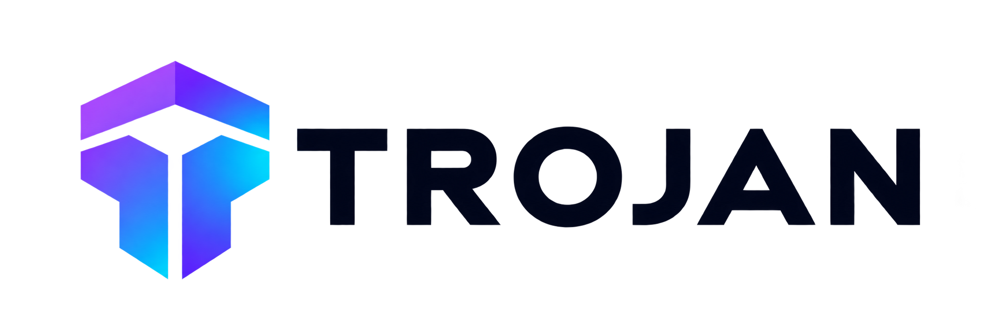
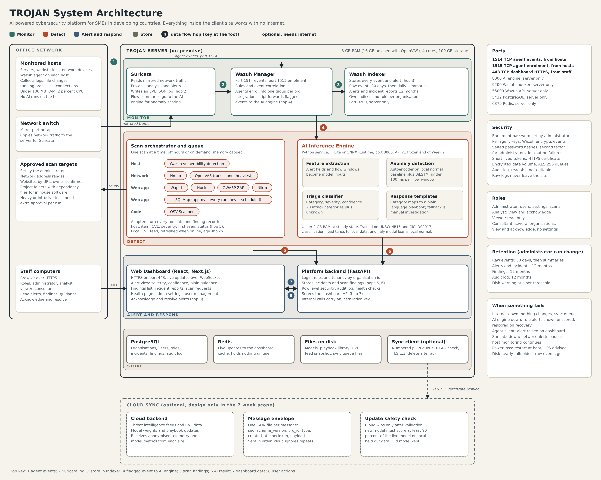
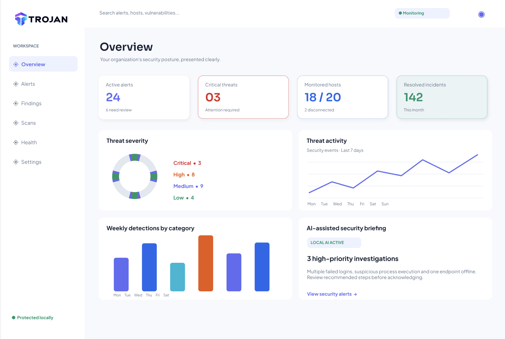
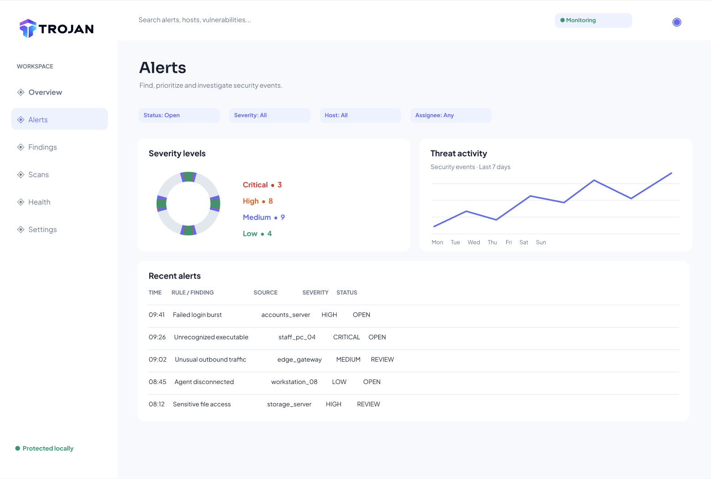

# TROJAN — AI-Powered Cybersecurity Platform



TROJAN is a university group project developed collaboratively by **Team TROJAN**. It is designed to help small and medium enterprises (SMEs) in developing countries monitor suspicious activity, identify vulnerabilities, and understand security alerts through plain-language guidance.

## Project status

The React frontend foundation is established in `ui/`. It includes a responsive application shell, a sidebar, a header, and four static KPI placeholders. Detailed application functionality and service integration remain under development.

The interface does not yet perform monitoring, scans, authentication, or AI inference. Search, profile, and navigation items are placeholders; security data is not connected.

## Planned capabilities

These capabilities are planned or in development:

- **AI-assisted threat detection:** help identify and prioritize suspicious activity.
- **Vulnerability scanning:** find known weaknesses on approved systems.
- **Local/offline monitoring:** support monitoring when internet connectivity is limited.
- **Security dashboard:** bring alerts, findings, scans, and system health together.
- **Plain-language security guidance:** explain alerts and suggested next steps.

## High-level technology architecture

| Area | Technology | Current scope |
| --- | --- | --- |
| Frontend | React + Vite, JavaScript/JSX, plain CSS | Application shell implemented |
| Backend | FastAPI | Planned service |
| Security monitoring | Wazuh and Suricata | Planned integration |
| AI inference | Python-based service | Planned service |
| Database | PostgreSQL | Planned storage |
| Cache/live updates | Redis | Planned integration |
| External AI advice | Optional Groq integration | Planned; requires internet access |

The prototype uses a minimal React + Vite frontend, although the original architecture described React with Next.js. See the [system architecture document](Architecture_Design/system_architecture.md) for the broader design. The architecture describes intended behavior, rather than functionality already delivered by the frontend.




## Getting started

Use a supported Node.js version: 20.19+ within Node 20, or Node 22.12 and newer, plus npm. The frontend was verified with Node.js 22.20.0.

```bash
git clone https://github.com/oteniyatobi/Trojan-Cyb.git
cd Trojan-Cyb/ui
npm install
npm run dev
```

Open the local URL printed by Vite, normally `http://localhost:5173`. Press Ctrl+C to stop the server.

See the [frontend guide](ui/README.md) for lint, build, folder structure, and implementation details. Backend and AI service setup are not included in the current frontend foundation.

## Project design and frontend preview

The [TROJAN Figma designs](https://www.figma.com/design/BodyaUM2wEUjrzZpivC7ys/Trojan?node-id=9-3) guide the interface.

The images below are **Figma design references**, showing planned screens and illustrative values. The running application currently implements only the basic shell and KPI placeholders.

### Overview design



### Alerts design



The remaining design screenshots are stored in `ui/screenshots/`. They are documentation assets and are not imported into the application.

## Team collaboration

Team TROJAN develops this project collaboratively. Keep changes focused on the relevant part of the repository and use the frontend guide to run checks before sharing UI work.
