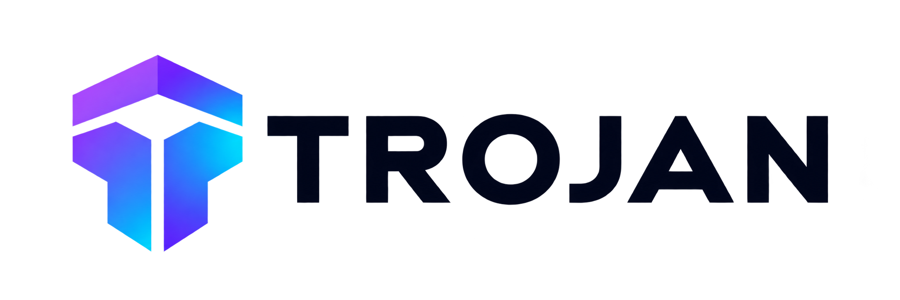
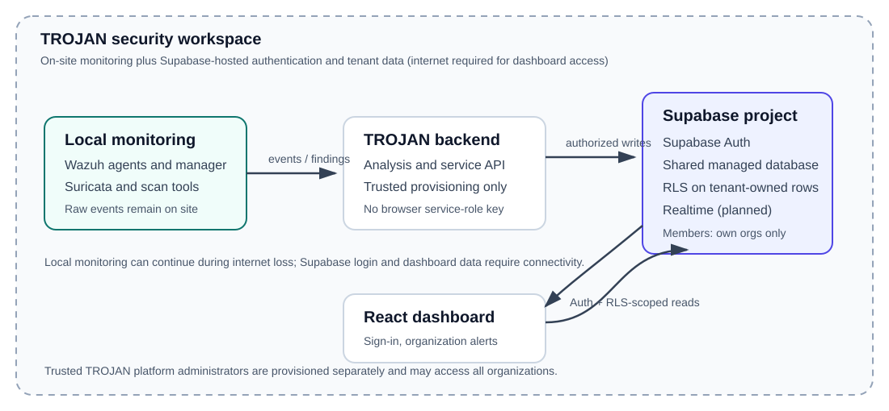
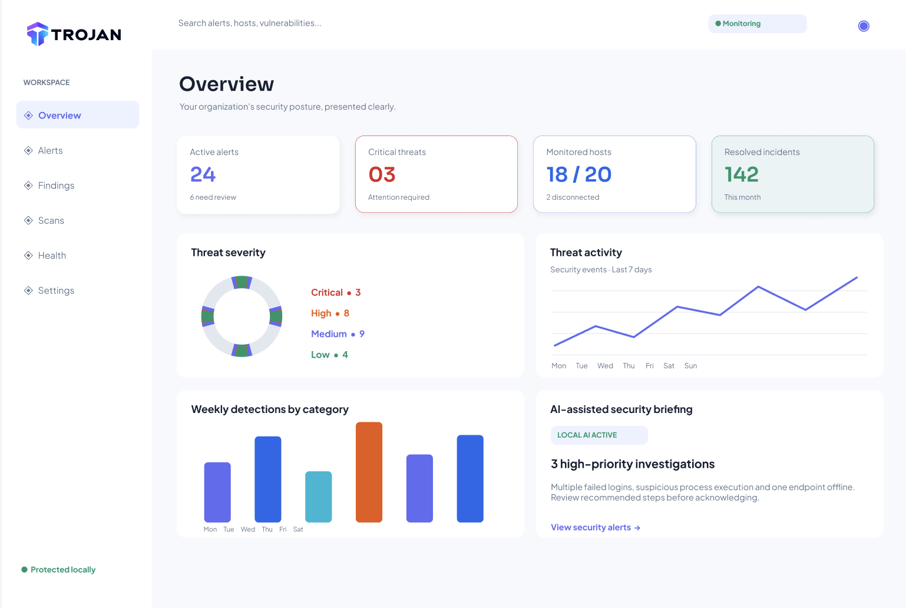
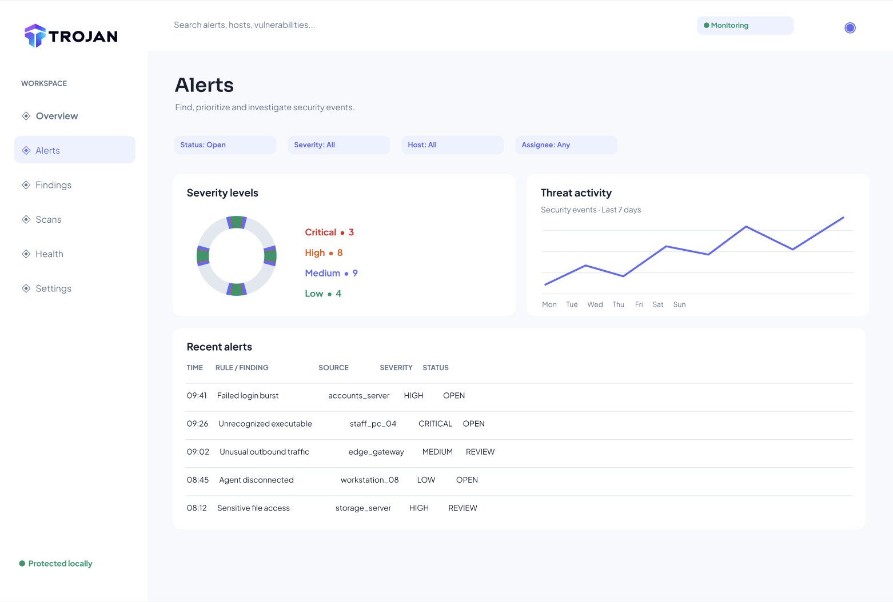

# TROJAN — AI-Powered Cybersecurity Platform



TROJAN is a university group project developed collaboratively by **Team TROJAN**. It is designed to help small and medium enterprises (SMEs) in developing countries monitor suspicious activity, identify vulnerabilities, and understand security alerts through plain-language guidance.

## Project status

The React frontend in `ui/` has Overview, Alerts, Findings, Scans, Health, and Settings pages. Supabase handles email/password authentication and organization-scoped alert and finding reads through Row Level Security (RLS). Scan requests, host health, and settings are still demo-only; the dashboard does not run scanner tools.

## Planned capabilities

These capabilities are planned or in development:

- **AI-assisted threat detection:** help identify and prioritize suspicious activity.
- **Vulnerability scanning:** find known weaknesses on approved systems.
- **Local monitoring:** collect events on site; the Supabase-backed dashboard and authentication require internet access.
- **Security dashboard:** bring alerts, findings, scans, and system health together.
- **Plain-language security guidance:** explain alerts and suggested next steps.

## High-level technology architecture

| Area | Technology | Current scope |
| --- | --- | --- |
| Frontend | React + Vite, JavaScript/JSX, plain CSS | Supabase sign-in and tenant alert/finding reads |
| Backend | Flask | Wazuh alert analysis and Supabase alert/finding ingestion |
| Security monitoring | Wazuh and Suricata | Planned integration |
| AI inference | Python-based service | Planned service |
| Authentication and database | Supabase Auth + Supabase-managed PostgreSQL with RLS | Initial sign-in and tenant schema |
| Live updates | Supabase Realtime | Planned integration |
| External AI advice | Optional Groq integration | Planned; requires internet access |

The prototype uses a minimal React + Vite frontend, although the original architecture described React with Next.js. See the [system architecture document](Architecture_Design/system_architecture.md) for the broader design. The architecture describes intended behavior, rather than functionality already delivered by the frontend.

## Supabase setup

Supabase is the hosted database and authentication platform. Its database engine is PostgreSQL; this project removes the self-hosted PostgreSQL container rather than PostgreSQL as the underlying database technology.

The initial schema and ingestion RPC are in [the Supabase migrations](supabase/migrations/). They use one shared Supabase project with organization-scoped rows and RLS policies. Organization members can only access records for organizations where they have a membership. Trusted TROJAN platform administrators are provisioned separately and can access all organizations. Client-side code uses only the Supabase publishable key; RLS is the security boundary, not the UI's organization filter.

1. Create a Supabase project.
2. Use the root `.env` for all settings. If it does not exist, copy `.env.example` to create it; if it already exists, preserve its values and add any missing variables from `.env.example`. Set both Supabase URL variables to your project URL and add the publishable key when you connect Supabase. Keep the service-role key server-only.
3. Apply all migrations using the Supabase CLI (`supabase link --project-ref <project-ref>` then `supabase db push`) or run them in timestamp order in the Supabase SQL Editor.
4. Enable Supabase Auth sign-ups and, preferably, email confirmation and CAPTCHA/rate limiting. The first user signs up with the organization name; the database creates that organization and assigns the user its `org_admin` role. Additional users still need to be assigned by an organization administrator workflow. Provision TROJAN platform admins separately.
5. To run in Docker, use `docker compose up --build` from the repository root. Both services use settings from the root `.env`. Alternatively, install and run the backend from `backend/` with `python -m pip install -r requirements.txt` and `python api.py`, then start the frontend from `ui/` with `npm install` and `npm run dev`; Vite reads the UI settings from the root `.env`.

## Deploying to Vercel

The root `vercel.json` configures one Vercel project with the existing Vite UI at `/` and the Flask API at `/v1/*`. The scanner scripts are command-line tools, not web services, so they are not deployed as separate services. The UI and API connect directly to Supabase; no Vercel service bindings are needed.

Import this GitHub repository into Vercel with the repository root (`./`) selected. Set Vercel's Production Branch to `tobi` if that is the branch you want deployed live; pushes to it will create production deployments, while other branches get preview deployments. Add the required variables in Vercel's project environment-variable settings for Production and Preview; a local `.env` is not uploaded:

- `VITE_SUPABASE_URL`
- `VITE_SUPABASE_PUBLISHABLE_KEY`
- `SUPABASE_URL`
- `SUPABASE_SERVICE_ROLE_KEY` (the Supabase server-side secret/service-role key, never a publishable key)
- `TROJAN_ORGANIZATION_ID`
- `TROJAN_INGESTION_API_KEY`
- `GROQ_API_KEY` (optional)
- `GROQ_MODEL` (optional; defaults to `openai/gpt-oss-120b`)
- `GROQ_TIMEOUT_SECONDS` (optional; defaults to `15`)
- `GROQ_MAX_RETRIES` (optional; defaults to `3`)

The Wazuh messenger must use the deployed project URL as `TROJAN_API_URL`. Its API key must match `TROJAN_INGESTION_API_KEY`. Scanner scripts that require installed Nmap or Wapiti executables still need an environment that provides those binaries; they are not run by this Vercel deployment.

The first-user sign-up flow creates an organization in the shared Supabase project; downloading the application alone does not create one because a user must provide its name. The Flask `/v1/analyze` endpoint analyzes and saves alert summaries to the organization configured for that backend installation. Raw alert evidence stays in the Wazuh Indexer; Supabase stores only an event reference, timestamp, severity, title, and AI review. `/v1/findings` saves scanner findings, which the dashboard reads for the selected organization. Both endpoints require the installation's ingestion API key; callers cannot select an organization. The service-role key stays on the backend, while dashboard reads use Supabase Auth and RLS. Scanner execution/orchestration and invitation-based member management remain future work.

When `GROQ_API_KEY` is configured, the current analyzer sends the alert JSON to Groq to generate its review. That is a separate external data flow from Supabase; disable Groq or use a local inference service if alert contents must not be sent to that provider.

The previous repository did not contain an application database schema or stored application records, so there is no existing application data to transfer.




## Getting started

Use a supported Node.js version: 20.19+ within Node 20, or Node 22.12 and newer, plus npm. The frontend was verified with Node.js 22.20.0.

```bash
git clone https://github.com/oteniyatobi/Trojan-Cyb.git
cd Trojan-Cyb/ui
npm install
npm run dev
```

Open the local URL printed by Vite, normally `http://localhost:5173`. Press Ctrl+C to stop the server.

See the [frontend guide](ui/README.md) for lint, build, folder structure, and implementation details. The current Flask analysis API uses Groq when configured; a separate local AI inference engine remains planned.

## Project design and frontend preview

The [TROJAN Figma designs](https://www.figma.com/design/BodyaUM2wEUjrzZpivC7ys/Trojan?node-id=9-3) guide the interface.

The images below are **Figma design references**, showing planned screens and illustrative values. They are not screenshots of the current application; scan requests, host health, and settings still use demo behavior.

### Overview design



### Alerts design



The remaining design screenshots are stored in `ui/screenshots/`. They are documentation assets and are not imported into the application.

## Team collaboration

Team TROJAN develops this project collaboratively. Keep changes focused on the relevant part of the repository and use the frontend guide to run checks before sharing UI work.
