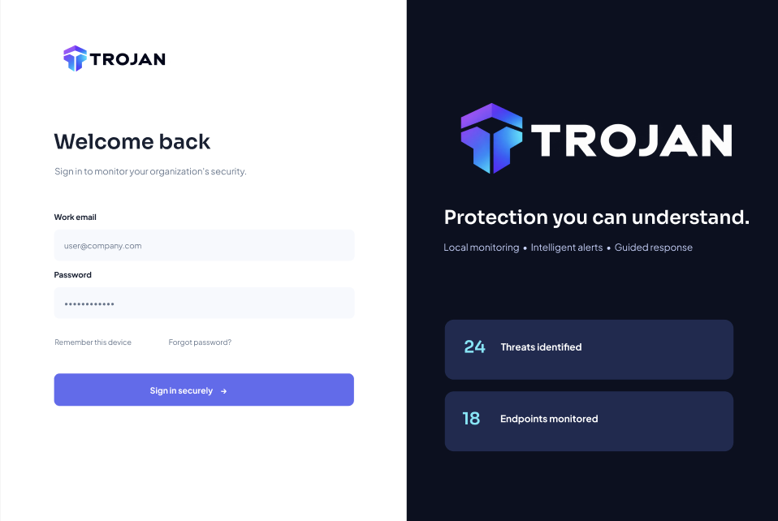

# TROJAN UI

The frontend for TROJAN, a university project helping SMEs in developing countries understand and monitor cybersecurity risks. The package name is `trojan-ui`. This phase provides a simple application shell for future development.

## Technology stack

- React and React DOM for the interface.
- Vite for local development and production builds.
- JavaScript with JSX and plain CSS.
- npm for dependencies and scripts.
- Oxlint for lint checks, as supplied by the official Vite React JavaScript template.

The project was created with `create-vite@9.3.3 --template react`. Its standard Vite configuration is retained. React type definitions supplied by the template support editor hints; the application uses JavaScript, not TypeScript.

## Requirements

Use Node.js 20.19+ within Node 20, or Node 22.12 and newer, and npm. Setup was verified with Node.js 22.20.0 and npm 10.9.3.

```bash
node --version
npm --version
```

## Install and start

From the repository root:

```bash
cd ui
npm install
npm run dev
```

Open the local URL printed by Vite, normally `http://localhost:5173`. Press Ctrl+C to stop the development server.

## Check and build

Run these commands from `ui/`:

```bash
npm run lint
npm run build
```

The build is written to `dist/`. To preview that build locally:

```bash
npm run preview
```

## Folder structure

```text
ui/
├── public/                 # Files served directly by Vite
├── screenshots/            # Figma screenshots for documentation only
├── src/
│   ├── assets/
│   │   ├── trojan-logo.png
│   │   └── trojan-logo-white.png
│   ├── components/
│   │   ├── Sidebar.jsx
│   │   └── Header.jsx
│   ├── styles/
│   │   └── main.css
│   ├── App.jsx
│   └── main.jsx
├── .gitignore
├── .oxlintrc.json
├── index.html
├── package.json
├── package-lock.json
├── vite.config.js
└── README.md
```

`main.jsx` mounts React. `App.jsx` combines the sidebar, header, and Overview content. Shared colors, fonts, spacing, and responsive rules live in `src/styles/main.css`.

## Branding and design references

The [TROJAN Figma designs](https://www.figma.com/design/BodyaUM2wEUjrzZpivC7ys/Trojan?node-id=9-3) guide the layout. Both official logos were copied unchanged from the project's supplied assets:

- `src/assets/trojan-logo.png`: regular logo used on the light sidebar.
- `src/assets/trojan-logo-white.png`: white-text version reserved for dark backgrounds; currently unused.

The logo uses its original 3:1 aspect ratio, with CSS controlling the display width and automatic height. Sora is used for major headings and Plus Jakarta Sans for interface text. Both load through Google Fonts, with local sans-serif fallbacks when internet access is unavailable.

### Screenshot previews

These are **Figma design references**, not screenshots of the implemented application. Charts, sample values, login, and other detailed features shown here are not implemented yet.




| File in `screenshots/` | Design |
| --- | --- |
| `trojan-login.png` | Login |
| `trojan-1.png` | Overview |
| `trojan-2.png` | Alerts |
| `trojan-3.png` | Alert detail |
| `trojan-4.png` | Scans |

Screenshots are kept outside `src/` and are not imported into React components. Other numbered images in the supplied assets show third-party interfaces and were not copied into the TROJAN screenshot collection.

## Currently implemented

- Responsive sidebar with TROJAN branding and Overview active styling.
- Header with static search text, local monitoring status, and profile placeholder.
- Overview heading and welcome message.
- Four KPI cards: Active Alerts, Critical Threats, Monitored Hosts, and Resolved Incidents.
- Shared CSS variables and desktop/mobile layouts.

KPI values display “—” and monitoring displays “Not connected”. Navigation labels do not open additional pages. No charts, mock-data generators, routing, authentication, API calls, or real security data are included.

## Planned next steps

1. Build the detailed application pages from the designs.
2. Add clearly labeled mock security data in a later phase.
3. Connect the UI to backend services as their APIs become available.

See the [project README](../README.md) for the planned platform capabilities and architecture.
