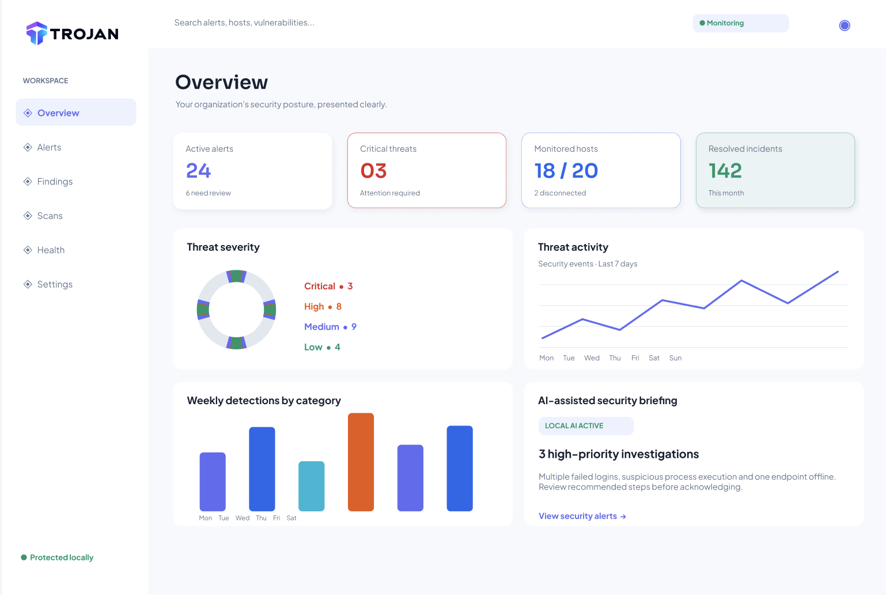
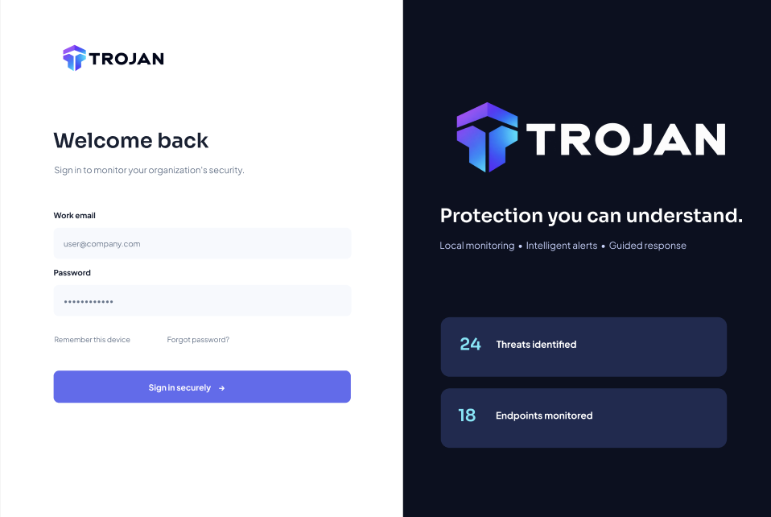

# TROJAN UI

The frontend for TROJAN, a university project helping SMEs in developing countries understand and monitor cybersecurity risks. The package name is `trojan-ui`. Supabase handles sign-in, organization membership, alerts, and findings. Scan requests, host health, and workspace preferences remain demo-only.

## Technology stack

- React and React DOM for the interface.
- Vite for local development and production builds.
- JavaScript with JSX and plain CSS.
- npm for dependencies and scripts.
- Oxlint for lint checks, as supplied by the official Vite React JavaScript template.

The project was created with `create-vite@9.3.3 --template react`. Vite reads frontend environment settings from the repository-root `.env`. React type definitions supplied by the template support editor hints; the application uses JavaScript, not TypeScript.

## Requirements

Use Node.js 20.19+ within Node 20, or Node 22.12 and newer, and npm. Setup was verified with Node.js 22.20.0 and npm 10.9.3.

```bash
node --version
npm --version
```

## Install and start

From the repository root:

```bash
# From the repository root, create .env from .env.example only if it does not already exist.
# Otherwise, add the missing VITE_SUPABASE_* values without overwriting existing settings.
cd ui
npm install
npm run dev
```

Open the local URL printed by Vite, normally `http://localhost:5173`. Press Ctrl+C to stop the development server.

## Check and build

Run these commands from `ui/`:

```bash
npm run lint
npm run build
```

The build is written to `dist/`. To preview that build locally:

```bash
npm run preview
```

## Folder structure

```text
ui/
├── public/                 # Files served directly by Vite
├── screenshots/            # Figma screenshots for documentation only
├── src/
│   ├── assets/
│   │   ├── trojan-logo.png
│   │   └── trojan-logo-white.png
│   ├── components/
│   │   ├── Sidebar.jsx
│   │   ├── Header.jsx
│   │   ├── Icon.jsx
│   │   ├── Badge.jsx
│   │   └── Charts.jsx
│   ├── data/
│   │   └── demo.json         # All starting demo records
│   ├── pages/               # One component per page, plus alert details
│   ├── styles/
│   │   └── main.css
│   ├── App.jsx
│   └── main.jsx
├── .gitignore
├── .oxlintrc.json
├── index.html
├── package.json
├── package-lock.json
├── vite.config.js
└── README.md
```

`main.jsx` mounts React. `App.jsx` handles Supabase authentication, organization selection, and organization-scoped alert/finding reads before rendering the selected page. Each page is a component in `src/pages/`. Shared colors, fonts, spacing, and responsive rules live in `src/styles/main.css`. Sidebar icons are small inline SVGs in `Icon.jsx`; no icon or chart packages are installed.

## Branding and design references

The [TROJAN Figma designs](https://www.figma.com/design/BodyaUM2wEUjrzZpivC7ys/Trojan?node-id=9-3) guide the layout. Both official logos were copied unchanged from the project's supplied assets:

- `src/assets/trojan-logo.png`: regular logo used in the light top bar and login.
- `src/assets/trojan-logo-white.png`: white-text version used in the dark top bar and login branding panel.

The logo uses its original 3:1 aspect ratio, with CSS controlling the display width and automatic height. Sora is used for major headings and Plus Jakarta Sans for interface text. Both load through Google Fonts, with local sans-serif fallbacks when internet access is unavailable.

### Screenshot previews

These are **Figma design references**, not screenshots of the implemented application. Some charts and pages are still prototypes; sign-in and organization-scoped alert and finding data use Supabase.





| File in `screenshots/` | Design |
| --- | --- |
| `trojan-login.png` | Login |
| `trojan-1.png` | Overview |
| `trojan-2.png` | Alerts |
| `trojan-3.png` | Alert detail |
| `trojan-4.png` | Scans |

Screenshots are kept outside `src/` and are not imported into React components. Other numbered images in the supplied assets show third-party interfaces and were not copied into the TROJAN screenshot collection.

## Currently implemented

- **Authentication:** Supabase email/password sign-in and signup. Signup records the organization name and creates its first admin membership.
- **Organizations:** membership-based organization selection, with database RLS enforcing tenant access.
- **Overview:** KPI cards, severity breakdown, and activity chart based on the selected organization's alerts.
- **Alerts:** organization-scoped Supabase alerts with severity/status filters and detail view.
- **Findings:** organization-scoped Supabase findings with search and severity filter.
- **Scans:** sample requests, status counts, and a form that adds a request to a local demo queue. It never contacts the target or runs a scanner.
- **Health:** host and service integration is not connected.
- **Settings:** account details and local demo preferences; changes are not persisted to Supabase.

Navigation uses hash routes and one React state value, without a routing library. Scan requests and settings remain in browser state and reset on reload. Search filters reset when leaving their page.

## Supabase data

The browser uses only `VITE_SUPABASE_URL` and `VITE_SUPABASE_PUBLISHABLE_KEY` from the repository-root `.env` during local development. Vercel builds use the same variables from Vercel's project environment settings. The privileged backend key must never be exposed to the UI.

RLS is the security boundary: the UI filters records for the selected organization, and Supabase policies independently enforce which rows the signed-in user can read. The Flask API ingests Wazuh alerts and scanner findings into Supabase using server-only credentials. Scanner execution and invitations/member management are not connected to the UI yet.

## Planned next steps

1. Connect the scanner execution workflow and real host-health reporting.
2. Persist workspace preferences and add invitations/member management.

See the [project README](../README.md) for the planned platform capabilities and architecture.

## Light and dark mode

Use the Dark mode switch in the profile dropdown or in Settings → Appearance. Both switches update the same theme immediately, without saving the demo preferences form. The theme is stored in browser local storage as `trojan-theme` and survives a reload; other demo settings still reset. If storage is unavailable, switching works for the current visit. Theme colors are defined in `src/styles/main.css`.

## Sign-in and sidebar

Create an account with an organization name or sign in with an existing Supabase account. If email confirmation is enabled, confirm the account first. The sign-out button ends the Supabase session. Protected dashboard routes return to the sign-in screen after signing out.

The top bar spans the full page. Its three-line button expands or collapses the sidebar using one boolean state; the icon stays the same in both states. Collapsed navigation keeps the page icons and accessible labels. On small screens the expanded sidebar overlays the content and closes after selecting a page. All interface corners are square. The favicon in `public/favicon.png` is the icon extracted from the official logo.

The top-bar profile opens a dropdown with Alerts, Settings, and the theme switch. Its arrow points up while open. Settings also appears at the bottom of the sidebar with a sliders icon. Overview and Findings use compact KPI cards with icons.

## Page routes

The URL changes when you navigate, using the part after `#`:

- `#/login`
- `#/overview`
- `#/alerts` and `#/alerts/ALT-001`
- `#/findings`
- `#/scans`
- `#/health`
- `#/settings`

`App.jsx` reads the hash and listens for `hashchange`. Browser Back/Forward, direct links, and reloads work without a router package or server rewrite rules. Unknown routes show a small page-not-found message. Routes are public in this demo; real login checks will be added with the API.
